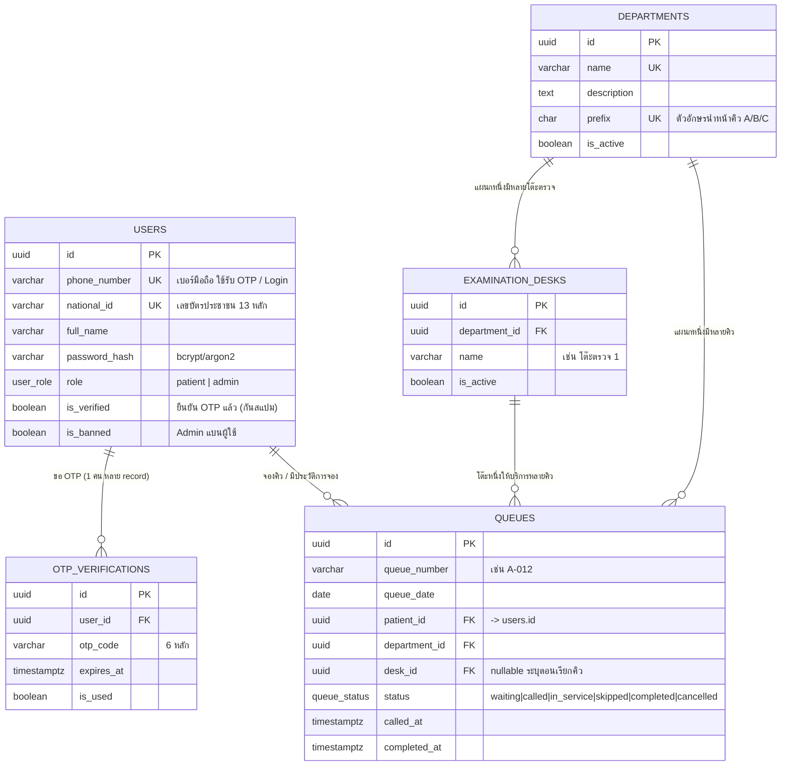

# ER Diagram — Q-Care Hospital Queue Management



## ความสัมพันธ์ (Relationships)

| ความสัมพันธ์ | ประเภท | กติกา |
|---|---|---|
| users → queues | 1 : N | ผู้ป่วย 1 คนจองได้หลายคิว — partial unique index บังคับ "1 คิว active ต่อ 1 แผนก" |
| users → otp_verifications | 1 : N | ขอ OTP ได้หลายครั้ง (ลบ user = ลบ OTP ทิ้ง CASCADE) |
| departments → examination_desks | 1 : N | ลบแผนก = ลบโต๊ะตรวจทิ้งด้วย (CASCADE) |
| departments → queues | 1 : N | ห้ามลบแผนกถ้ายังมีคิวอยู่ (RESTRICT) |
| examination_desks → queues | 1 : N | Admin เรียกคิวแล้วกำหนดโต๊ะ (ลบโต๊ะ = SET NULL) |

## สถานะคิว (queue_status lifecycle)

```
waiting ──(Admin เรียก)──> called ──> in_service ──> completed
waiting ──(Admin ข้าม)──> skipped
waiting/called ──(ยกเลิก)──> cancelled
```

> ประวัติการจองของผู้ป่วย = record ใน `queues` ที่ status อยู่ใน
> completed / cancelled / skipped (คิววันเก่าเก็บตาม `queue_date`)
